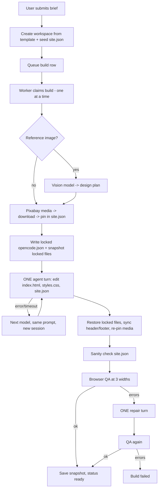

# Dukan Builder — How a Website Build Works

Written from the code as it is today (branch `security-fixes`). File references are to `/home/ubuntu/dukan-builder`.

## Short answer: is it built "in one go"?

**Mostly yes, for the creative part.** One AI agent turn writes the three editable files (`index.html`, `styles.css`, `site.json`) from one big prompt. There is no separate plan → content → design → polish pipeline.

But the full build is a **pipeline of 6 stages**, and only stage 4 uses the main AI:

| # | Stage | Uses AI? | Where |
|---|-------|----------|-------|
| 1 | Create site (copy template, seed `site.json`) | No | `app/api/sites/route.ts`, `lib/provision.ts` |
| 2 | Queue build | No | `app/api/sites/[id]/build/route.ts` |
| 3 | Prepare: vision on reference image, fetch + download stock media | Vision model (only if an image was uploaded) | `worker/build-worker.ts`, `lib/vision.ts`, `lib/media.ts` |
| 4 | **Agent turn** (the "one go"): AI edits 3 files | **Yes** | `lib/agent.ts`, `lib/prompts.ts` |
| 5 | Post-processing + QA in a real browser | No | `restoreLocked`, `syncChrome`, `mergeMedia`, `qa/*.cjs` |
| 6 | Repair turn (only if QA fails, max once) → QA again → save snapshot | Yes (only on failure) | `worker/build-worker.ts` |

Everything except `index.html`, `styles.css`, `site.json` is a **locked template** (about, services, gallery, contact, login, dashboard, admin pages and all JS). The AI cannot change them; the worker restores them after every turn.

---

## Stage 1 — Site creation (`POST /api/sites`)

1. User must be signed in; rate limit 10 sites / hour.
2. Validates business name (2–80 chars), checks the platform banned-words list.
3. If a design image was uploaded: size ≤ 8 MB, file type verified from the real bytes (PNG/JPEG/WebP), saved to `UPLOADS_DIR` (mode 0640).
4. `provisionWorkspace()` copies `template/` into `/opt/tenants/<userId>/<slug>/` and writes a starter `site.json` from the brief (name, phone, address, hours, services parsed from lines `name | desc | price`, palette from category). The slug is stamped into the HTML pages. The reference image is copied to `design/reference.<ext>`.
5. Inserts `sites` + `briefs` rows in one transaction (workspace is deleted if the DB insert fails). Generates the owner credentials for the site.

## Stage 2 — Queueing (`POST /api/sites/:id/build`)

- Checks: signed in, owns the site, rate limit 5/hour, "beta builds" feature flag on, no build already queued/running, quota not used up.
- Inserts a `builds` row with `status='queued'` and sets the site to `building`.
- Chat edits (`POST /api/sites/:id/chat`) work the same way but create a `kind='refine'` build (2–2000 chars, 20/hour, only after the first build is `ready`).

## Stage 3 — The worker picks it up

- The worker runs **inside the Next.js process** (`instrumentation.ts` → `startBuildWorker`). It polls every **8 seconds** and runs **one build at a time**.
- On startup, any build still marked `building` is failed with "interrupted by a server restart".
- The build is claimed atomically (`UPDATE … WHERE status='queued'`).
- Build kinds: `build` (full, uses quota), `refine` (chat edit, free), `revert` (restores a saved version, no AI, no QA).
- For a full `build`, **one quota unit is consumed at the start** (it is not refunded if the build later fails).

### 3a. Design analysis (only if a reference image exists and no plan is stored)
`lib/vision.ts` runs `opencode run` with a vision model chain (`glm-5.3-flash-free` → `nemotron-3.5-super-vl-free` → `space-bunny-free` → `mimo-v2.6-flash-free`). It returns a JSON **design plan**: style, layout, ordered sections, colour palette, typography, image/video search keywords. Saved to `briefs.design_plan` and `design/plan.json`. If vision fails, the build continues with category defaults.

### 3b. Media
- Stored media is re-used if present; otherwise `lib/media.ts` searches **Pixabay** (images + optional video) using the plan's keywords + category keywords. With no Pixabay key it uses curated Unsplash IDs.
- Every image is **downloaded into `<workspace>/media/`** (hotlinks expire); `site.json` points at `/media/...` paths. If fewer than 3 images downloaded, it refetches.
- Media fields (`hero_image`, `hero_video`, `about_image`, `gallery`, `media_credits`) and the palette from the design plan are written into `site.json` **before** the AI runs. The AI is told not to touch them.

## Stage 4 — The agent turn (the "one go")

1. **Model chain:** `opencode/deepseek-v4.1-flash-free` → `nemotron-3.5-lightning-free` → `space-bunny-free` → `glm-5.3-flash-free` (configurable with `OPENCODE_BUILD_MODELS`; models with no API key are skipped).
2. **Security setup before every spawn:** a restrictive `opencode.json` is written (bash, webfetch, websearch, task, external_directory etc. all denied); a snapshot is taken of every locked file; `opencode serve` starts fresh on a random localhost port with a random password and a filtered environment (`lib/agent-env.ts`).
3. **One prompt** (`renderBuildPrompt`, `lib/prompts.ts`) is sent. It contains: read `AGENTS.md` first; 6 hard rules (edit only 3 files; keep all slots/IDs/scripts/links; do not change media fields; never invent reviews/prices/stats; keep the category; copy menu items and prices verbatim); the business facts between `|||USER-BRIEF|||` delimiters; the design reference section; and 5 tasks (write `site.json` content, rebuild `index.html`, rebuild `styles.css`, don't break locked pages, never start servers/fetch URLs).
4. The worker waits for the agent to finish by **polling OpenCode's own SQLite database** every 1.5 s (`session_v2.time_idle` / `session_message`), with a **30-minute timeout**.
5. **Fallback:** if a model errors or times out, the server is stopped and the **next model gets the same prompt in a brand-new session on the same workspace** (the workspace is not reset first).
6. The server is always stopped in a `finally`.

For `refine` builds the prompt is much shorter (`renderRefinePrompt`): the user's message plus the same hard rules. Note: each refine starts a **fresh session with no memory of earlier chat messages**.

## Stage 5 — After the agent finishes (deterministic)

In this order:
1. `restoreLocked` — `sanitizeWorkspace` (removes symlinks / hard links), puts every locked file back byte-for-byte (including `opencode.json`), deletes any extra `.html/.js/.css` file the AI invented.
2. `syncChrome` — copies the homepage `<header>` and `<footer>` (between `chrome:` markers) into about/services/gallery/contact so the menu/footer match everywhere; fixes `#anchor` links and the current-page marker.
3. `mergeMedia` — re-pins the media fields in `site.json` in case the AI changed them.
4. **Sanity check** — `site.json` must parse, have `business_name`, and the same `slug`, otherwise the build fails.
5. **QA** (`qa/qa-check.cjs` + `qa/browser-check.cjs`, 5 min limit, separate process): static checks plus a real Chromium at **390 / 768 / 1440 px** — broken images, JS errors, horizontal overflow, contrast, tap targets, required slots/IDs, booking/enquiry forms, dashboards, CSV export, auth guards, menu-vs-brief comparison. Any `error` fails QA (warnings do not).

## Stage 6 — Repair, then finish

- If QA has errors: **one repair turn** (10-minute limit) with a prompt listing the **first 12 errors**. Then restore locked files → sync chrome → re-pin media → QA again. If QA still has errors the build **fails** (`QA failed after repair`).
- On success: refine builds post the AI's one-line reply to the chat; a snapshot of the 3 editable files is saved to `<workspace>/.history/<buildId>/` (last 20 kept) for one-click revert; build and site become `ready`.
- On any failure: build = `failed` with a classified reason, site goes back to `draft`.

## Publishing (separate, manual)

`publishWorkspace()` → sanitize workspace → copy to a staging dir (no symlinks) → drop `opencode.json`, `AGENTS.md`, `design/`, `.history/` → make world-readable → atomic rename into `/opt/www/published/<slug>/`. Caddy serves `<slug>.dukanbot.website` from there.

## Typical timing
Per the ops docs: agent 4–6 min, QA ~1 min, a repair turn 2–5 min. Normal total 8–15 minutes.

## Flow diagram

